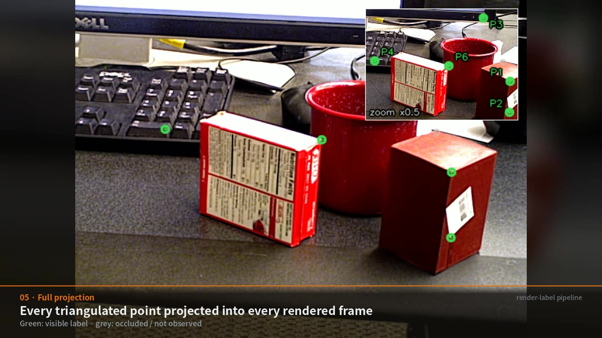
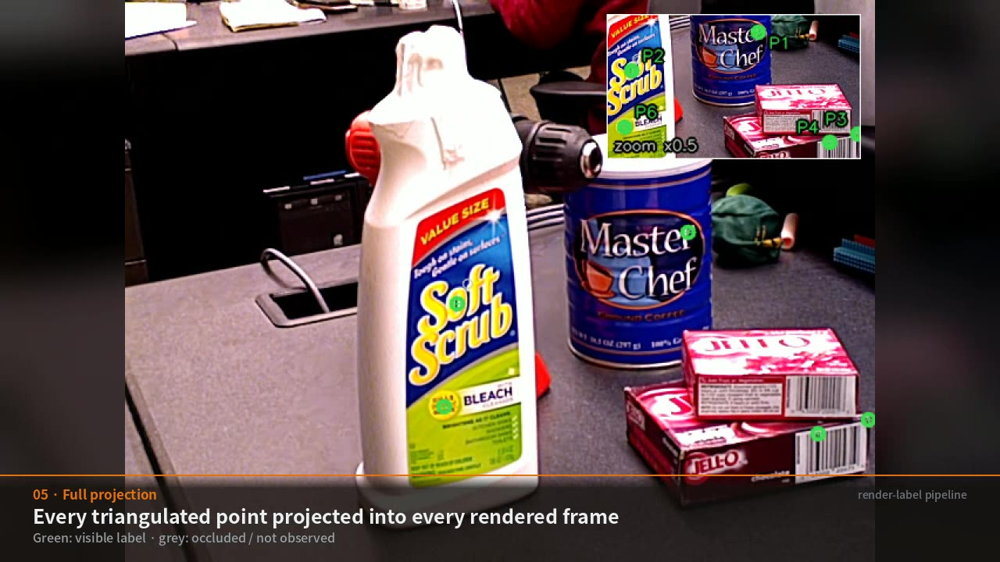

# render-label-pipeline

**Saturation-aware view selection for render-based keypoint labels.**
Annotate a handful of rendered views, triangulate the keypoints, and project
exact labels into every frame of a COLMAP reconstruction — without annotating
thousands of images.

> **Demo videos** (1280×720, 30 fps, produced with this pipeline — see
> [Demo videos](#demo-videos)):
>
> [](docs/media/demo_ycbv_1.mp4)
> [](docs/media/demo_ycbv_2.mp4)

## Demo videos

Two YCBV-style orbit captures, six control points each, labelled end to end by
the pipeline:

| demo | rendered frames | annotated views | video |
|---|---|---|---|
| A | 191 | 2 seed + 4 selected | [demo_ycbv_1.mp4](docs/media/demo_ycbv_1.mp4) |
| B | 204 | 2 seed + 4 selected | [demo_ycbv_2.mp4](docs/media/demo_ycbv_2.mp4) |

The videos are process-only (no accuracy card) and show the five stages:
sparse reconstruction → 3DGS rendering → saturation-aware view selection →
triangulation from the clicks → projection of the labels into every render.
In the last stage a green ring means *the label is visible in this frame*, a
grey hollow ring means *occluded or not observed*.  The clicks were captured in
an external annotation tool and imported through the same JSON contract the
built-in annotator writes (see
[Using your own annotation tool](docs/08_usage.md#62-using-your-own-annotation-tool-json-contract));
selection, triangulation, projection and rendering are the pipeline itself.
The videos were produced with `examples/make_demo_video.py` on scenes that keep
their renders at the scene root; the invocation pattern (including the
`--visibility` file that drives the green/grey markers) is in
[Gallery and demo video](docs/08_usage.md#9-gallery-and-demo-video).

## Abstract

This repository packages a complete pipeline that turns a video or image set
into dense keypoint labels: COLMAP structure-from-motion, 3D Gaussian Splatting
on a fixed-size subset of the registered frames, re-rendering of *every* COLMAP
pose with one shared pinhole camera, a two-view seed annotation, prediction of
the saturated view count
`N_sat = ceil(Theta_span / (2 * theta_eff))` plus greedy angular view
selection, annotation of only those views, and multi-view DLT triangulation
whose result is projected into all renders as labelme JSON.

## Why render the frames at all

- Every training frame exists as a render at **exactly the same pose**, in **one
  shared pixel space** (one focal length, one principal point). Multi-view
  triangulation is only well-posed when all views share a camera model; COLMAP's
  per-image `SIMPLE_RADIAL` intrinsics do not.
- Annotation effort scales with the number of *distinct viewpoints* needed, not
  with the number of frames. The selection rule predicts that number from pose
  geometry alone and picks well-spread views, so 4–8 annotated frames can label
  a whole capture.
- Labels are then produced by projection, so they are exact (up to triangulation
  error) and cost nothing per frame.

## Pipeline

```
 video / images
      |
      v
 [00] extract frames (optional)
      |
      v
 [01] COLMAP SfM --------------------------> sparse/0   (poses + intrinsics)
      |
      v
 [02] pick N frames, undistort -------------> 3dgs/{images,sparse/0}
      |                                       |
      |                                       v
      |                                     train 3DGS (30k iters)
      v
 [03] render every COLMAP pose -------------> 3dgs/renders/{images,message}
      |
      +--> [04] 2-view cold start: pick the seed pair from poses alone,
      |         annotate those 2 frames (GUI)          -> work/seed.json
      |
      v
 [05] N_sat = ceil(Theta_span / (2*theta_eff)); greedy angular cover
      |                                             -> work/selection.json
      v
 [06] annotate the N_sat selected frames (GUI)       -> work/selected.json
      |
      v
 [07] multi-view DLT triangulation -> project into all renders
                                                     -> 3dgs/labels/*.json
```

Steps 04 and 06 are the only manual steps. Everything else runs headless.

## Requirements

| side | what | notes |
|---|---|---|
| label side | Python 3.9+, `numpy scipy opencv pillow` | `environment.yml` / `requirements.txt` |
| label side, optional | `pycolmap>=0.6` (tested with 4.x) | only the subset stage (02) needs it |
| 3DGS side | PyTorch + CUDA, [gaussian-splatting](https://github.com/graphdeco-inria/gaussian-splatting) with submodules | separate conda env, see [docs/02_train_3dgs.md](docs/02_train_3dgs.md) |
| SfM | COLMAP (`colmap` CLI) | `apt install colmap` or `conda install -c conda-forge colmap` |

A CUDA GPU is required for 3DGS training and rendering. Annotation needs a
desktop session (OpenCV window; over SSH use `ssh -X` or a VNC session).

## Install

### Label side (conda, recommended)

```bash
git clone <this-repo> render-label-pipeline
cd render-label-pipeline

conda env create -f environment.yml      # creates env "rlabel"
conda activate rlabel

# optional: install the `renderlabel` console command
pip install -e .
```

### Label side (venv/pip alternative)

```bash
python3 -m venv .venv && . .venv/bin/activate
pip install -e ".[subset]"               # add pycolmap for the subset stage
```

### 3DGS side

Install the 3DGS environment exactly as in
[docs/02_train_3dgs.md](docs/02_train_3dgs.md). The scripts call it through
`conda run -n gs`, so both environments coexist without switching.

### Verify the installation

In the label environment, from the repository root:

```bash
python -m unittest discover -s tests -v   # 12 tests, all pass
python -m renderlabel --help              # lists the five CLI stages
```

The first command is a full non-interactive check of the numerical core
(projection, DLT, outlier rejection, view selection, cold start, label
projection); it needs no GPU and no data.

> **Tested from a clean clone** — on 2026-11-13, Ubuntu 22.04, two fresh
> environments were built from this README alone:
>
> | path | Python | numpy / scipy / opencv / pillow / pycolmap | result |
> |---|---|---|---|
> | `conda env create -f environment.yml` | 3.10.22 | 2.2.6 / 1.15.2 / 5.0.0 / 12.3.0 / 4.1.1 | 12 tests OK, `--help` OK, stage 02 OK |
> | `pip install -e ".[subset]"` in a venv | 3.11.11 | 2.4.6 / 1.17.1 / 5.0.0 / 13.0.0 / 4.2.1 | 12 tests OK, `--help` OK, stage 02 OK |
>
> Stage 02 was exercised end to end on a real 204-image COLMAP model
> (`subset` → 12 undistorted PINHOLE cameras, pose and point2D round-trip exact
> to 0.0). In the venv, `select` and `triangulate` were also run on that scene
> and reproduced the recorded demo numbers (same 4 selected frames; residual
> median 0.467 px / mean 0.600 px). The 3DGS side depends on your CUDA/driver
> pair and was not rebuilt in that check; follow
> [docs/02_train_3dgs.md](docs/02_train_3dgs.md) and use its import check. Note
> that pycolmap 4 refuses an inconsistent model (a `points3D` track pointing at
> a missing image); see [docs/faq.md](docs/faq.md).

## Quick start

A scene is one folder with an `images/` subfolder:

```
/data/box1/
  images/          # input frames (or run 00 to extract them from a video)
```

Run, in order:

```bash
export SCENE=/data/box1                # or edit scripts/config.sh

bash scripts/00_extract_frames.sh      # only if you start from a video
bash scripts/01_colmap.sh              # SfM           -> sparse/0
bash scripts/02_train_3dgs.sh          # subset + train -> 3dgs/output/...
bash scripts/03_render.sh              # all poses     -> 3dgs/renders/
bash scripts/04_seed_views.sh          # GUI: annotate 2 frames
bash scripts/05_select_frames.sh       # N_sat + selection
bash scripts/06_annotate_selected.sh   # GUI: annotate the selected frames
bash scripts/07_triangulate.sh         # labels for every render
```

`scripts/run_all.sh` runs the headless stages 01–03 and then prints the rest.
If your input is a video,
`VIDEO=/data/take1.mp4 bash scripts/00_extract_frames.sh` writes the frames
first.

**Full manual:** [docs/08_usage.md](docs/08_usage.md) — scene layout, every
stage with its inputs/outputs and checks, the annotation keys, how to plug in
your own annotation tool, selection tuning, gallery/video generation, and
troubleshooting.

## What you get

```
<SCENE>/3dgs/labels/<frame>.json   labelme JSON, one "point" shape per keypoint
<SCENE>/3dgs/labels/points3d.csv   triangulated 3D points, residuals per point
<SCENE>/3dgs/labels/summary.json   coverage, residuals, failed points
<SCENE>/3dgs/overlay/<frame>.png   QC overlay of the projected labels
```

A label is written only for frames where the point actually projects inside the
image. `summary.json` reports, per point, how many annotated views were used and
in how many frames the label exists.

## The selection rule

Nothing in steps 04–05 looks at a 2D observation before the seed clicks:

1. **Seed pair (no annotations).** Fit the point that minimises the distance to
   all camera optical axes (a pose-only proxy for the object centre), then take
   the pair of frames whose rays are widest apart. The pair is capped at
   `SEED_MAX_ANGLE` (default 160°): two exactly opposite cameras put the object
   on the baseline, where depth is unobservable.
2. **Coarse X0.** Triangulate the seed clicks (multi-view DLT), take the
   centroid of the seed points.
3. **Candidates.** A frame is a candidate when every seed point projects inside
   the image with a `MARGIN` px border.
4. **Prediction.** `Theta_span` is the largest pairwise angle between the
   candidate rays *from X0*; `N_sat = ceil(Theta_span / (2*theta_eff))`.
   `theta_eff = 11.5°` is the value fitted on the paper's seven sequences;
   recalibrate it on your own data (see
   [docs/05_select_frames.md](docs/05_select_frames.md)).
5. **Selection.** Greedy angular cover: start from the seed pair, repeatedly add
   the candidate farthest from the selected set, subject to a hard `GUARD`
   minimum angle (5°). If no candidate satisfies the guard the search stops —
   it never relaxes the guard. The realised count can therefore be smaller than
   `N_sat`; `selection.json` reports both `n_sat` and `n_selected`.

## Configuration

All knobs live in [scripts/config.sh](scripts/config.sh) and can be overridden
per run (`SCENE=... MARGIN=40 bash scripts/05_select_frames.sh`):

| variable | default | meaning |
|---|---|---|
| `SCENE` | — | scene folder (required) |
| `N_FRAMES` | 250 | frames kept for 3DGS training |
| `ITER` | 30000 | 3DGS training iterations |
| `GS_REPO` | `$HOME/gaussian-splatting` | upstream 3DGS checkout |
| `POINTS` | `examples/points.txt` | keypoint names, one per line |
| `THETA_EFF` | 11.5 | degrees per view in the saturation rule |
| `GUARD` | 5 | minimum ray angle between selected views (deg) |
| `MARGIN` | 20 | px border a point must keep to count as visible |
| `SEED_MAX_ANGLE` | 160 | cap on the seed-pair ray angle (deg) |
| `LABEL_ENV` / `GS_ENV` | `rlabel` / `gs` | conda env names; set to `""` to use the current env |

## Demos on the paper's data

Two end-to-end demos run steps 04–07 on real render sets that ship with the
paper's data, and score the result against independent labels and ground-truth
3D points:

| demo | data | frames | points | command |
|---|---|---|---|---|
| ArUco | ChArUco board, `train/0000` | 946 | 15 | `SCENE=... bash examples/charuco/run_demo.sh` |
| YCBV | `seq00_room_20261012` | 1000 | 19 | `SCENE=... bash examples/ycbv/run_demo.sh` |

The only simulated part is the GUI click: `examples/make_clicks.py` copies the
dataset's existing render-domain labels (ArUco detections; YCBV optical-flow
labels) into the annotator's JSON format. Steps 05–07 and the evaluation are
the real pipeline. Each demo reports the held-out 2D error (frames that never
contributed a click), a random-view baseline at the same budget, and the 3D
error against ground truth after a Sim(3) leave-one-out fit. See
[examples/README.md](examples/README.md).

## Documentation

| step | document |
|---|---|
| full usage manual | [docs/08_usage.md](docs/08_usage.md) |
| 00 frame extraction | [scripts/00_extract_frames.sh](scripts/00_extract_frames.sh) |
| 01 COLMAP | [docs/01_colmap.md](docs/01_colmap.md) |
| 02 subset + 3DGS training | [docs/02_train_3dgs.md](docs/02_train_3dgs.md) |
| 03 render all poses | [docs/03_render.md](docs/03_render.md) |
| 04 two-view seed | [docs/04_seed_views.md](docs/04_seed_views.md) |
| 05 saturation + selection | [docs/05_select_frames.md](docs/05_select_frames.md) |
| 06 annotate selected | [docs/06_annotate_selected.md](docs/06_annotate_selected.md) |
| 07 triangulate + project | [docs/07_triangulate.md](docs/07_triangulate.md) |
| troubleshooting | [docs/faq.md](docs/faq.md) |

## Repository layout

```
renderlabel/          the package: geometry, views, subset, render, select,
                      annotate, triangulate_project, cli
scripts/              00–07 shell wrappers + config.sh + run_all.sh
docs/                 per-stage reference docs + 08_usage.md + media/
examples/             runnable demos (charuco/, ycbv/), label I/O, gallery,
                      demo video, visibility helper
tests/                unittest suite (12 tests, no data, no GPU)
```

## Tests

```bash
python -m unittest discover -s tests -v
```

Twelve synthetic tests cover projection and the message schema, exact DLT,
outlier rejection, the selection rules (farthest pair, Theta_span, N_sat, guard
truncation), and two end-to-end runs of the cold start and the label
projection.

## Notes and limits

- **The labels live in the render pixel space** of the shared pinhole camera.
  That is the intended use: train/evaluate on renders of the same scene. Because
  the 3D points are recovered in the COLMAP world frame, you *can* also project
  them into the original real images with their own intrinsics — but then the
  accuracy is limited by the SfM poses and by the 3DGS geometry, and there is no
  render-domain ground truth to check against.
- The 3DGS must be trained on frames from the same reconstruction you render, or
  the renders will not line up with the poses. Step 02 enforces the undistorted
  PINHOLE subset for exactly this reason.
- Inputs should show one rigid object (or board) from many angles. The coarse
  X0 is a single point, so the rule assumes the keypoints span a small volume
  relative to the camera distance.
- This pipeline annotates; it does not train a detector. The labelme JSON is
  directly consumable by common keypoint-training toolchains.

## License

MIT — see [LICENSE](LICENSE).
